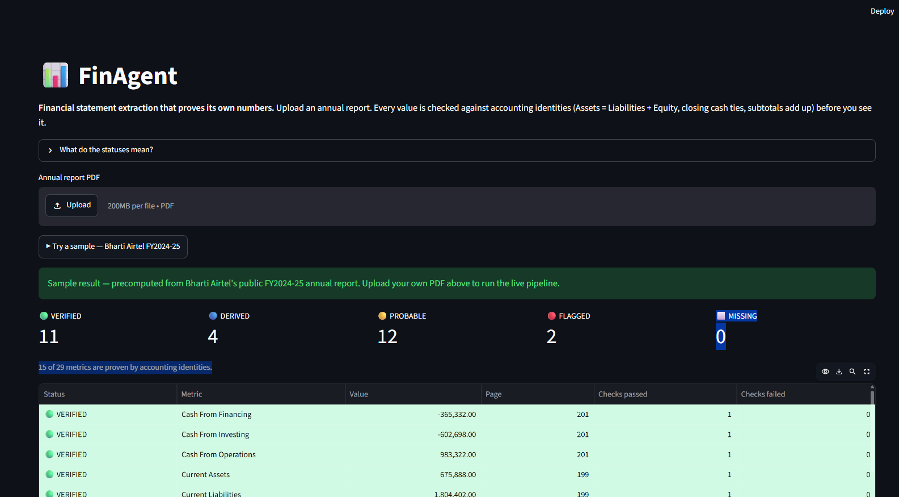

# Financial PDF Extraction Agent (v2)

[](https://github.com/Akshu24Tech/financial-pdf-extraction-agent/actions/workflows/ci.yml)
[](https://github.com/Akshu24Tech/financial-pdf-extraction-agent/releases)

Give it any company's annual-report PDF. It finds the financial statements,
pulls out the key numbers, **proves each one is correct**, and writes a tidy
Excel where every value carries its own receipt (page number, the exact label
it came from, and which checks it passed).

**🚀 [Open the live demo](https://financial-pdf-extraction-agent-cx3yk9zkkmekw9o8kda8zp.streamlit.app/)** — click *Try a sample* for an instant result.



**🎬 [Watch the demo](docs/demo.mp4)** — a short screen recording of the Streamlit app extracting and verifying a report end to end.

---

## Try it in 30 seconds

**Online:** open the [live demo](https://financial-pdf-extraction-agent-cx3yk9zkkmekw9o8kda8zp.streamlit.app/).

**Locally:** a web demo ([`app.py`](app.py)) wraps the exact same engine as the CLI, so it
can never disagree with the tests.

```powershell
pip install -r requirements.txt
streamlit run app.py
```

Then either upload your own annual-report PDF, or click **▶ Try a sample —
Bharti Airtel FY2024-25** for a precomputed result that renders instantly (no
PDF needed, no 30-200s run). Every metric shows its status, the page it came
from, and the accounting checks it passed or failed, plus a downloadable Excel.

> The sample is a bundled JSON of the extracted *numbers* (facts from a public
> report); the copyrighted PDF itself is never shipped.

---

## The one idea behind it

> **Accuracy comes from verification, not extraction.**

Reading numbers off a PDF is easy to get *almost* right and very hard to get
*exactly* right — tables are borderless, layouts differ per company, a "5" in
the wrong column ruins everything. So this tool doesn't trust what it reads.

Financial statements are **self-verifying**. They obey rules:
- Assets = Liabilities + Equity
- Current + Non-current = Total
- The closing cash in the cash-flow statement equals cash on the balance sheet

So every extracted number is checked against these rules. A value that passes a
rule is **VERIFIED**. A value that breaks one is **FLAGGED** for a human. We
never hand over a confident-but-wrong number.

---

## How it works — 7 stages, like an assembly line

```
   PDF
    │
    ▼
┌─────────────┐   What kind of PDF is this? Page sizes, orientation,
│ 1 PROFILE   │   and whether each page has readable text.
└─────────────┘
    │
    ▼
┌─────────────┐   Some reports print two pages side-by-side on one wide
│ 2 GEOMETRY  │   sheet. Split those back into single logical pages.
└─────────────┘
    │
    ▼
┌─────────────┐   Which pages ARE the Balance Sheet / P&L / Cash Flow?
│ 3 LOCATE    │   (and prefer the consolidated version)
└─────────────┘
    │
    ▼
┌─────────────┐   Read the chosen pages line by line: "label … numbers".
│ 4 EXTRACT   │   Borderless-table safe — rebuilds rows from coordinates.
└─────────────┘
    │
    ▼
┌─────────────┐   Clean the numbers and match each label to our standard
│ 5 NORMALIZE │   vocabulary ("Turnover" and "Net sales" both -> revenue).
└─────────────┘
    │
    ▼
┌─────────────┐   Prove the numbers using accounting identities.
│ 6 VALIDATE  │   -> VERIFIED / PROBABLE / FLAGGED / MISSING
└─────────────┘
    │
    ▼
┌─────────────┐   A number the report never printed but the identities
│ 6b DERIVE   │   pin down exactly? Compute it. Mark it DERIVED.
└─────────────┘
    │
    ▼
┌─────────────┐   Excel: value + status + page + matched label + checks.
│ 7 WRITE     │   Colour-coded so you see trust level at a glance.
└─────────────┘
    │
    ▼
   metrics.xlsx
```

**Status colours in the Excel:** 🟢 VERIFIED · 🟡 PROBABLE · 🔴 FLAGGED ·
🔵 DERIVED · ⬜ MISSING.

---

## Run it

```powershell
# web demo (upload a PDF or click the sample button)
.venv\Scripts\streamlit run app.py

# one report, on the command line
.venv\Scripts\python.exe finagent_single.py test_pdfs\TCS_2024-2025.pdf

# scorecard across all test reports
.venv\Scripts\python.exe benchmark.py
```

Output lands in `output\<Company>_metrics.xlsx`. All commands use the project
venv (`.venv`). First-time setup: `pip install -r requirements.txt`.

---

## Install a released build

The project is published on PyPI (the distribution name is `akshu-finagent`;
the import name stays `finagent`):

```powershell
pip install akshu-finagent
```

Each `vX.Y.Z` tag also builds the wheel + sdist and attaches them to a
[GitHub Release](https://github.com/Akshu24Tech/financial-pdf-extraction-agent/releases).

---

## CI/CD

This repo doubles as a hands-on CI/CD build-out (tracked level-by-level in
[`WORKLOG.md`](WORKLOG.md)):

- **CI** (`.github/workflows/ci.yml`) — every push and PR runs `ruff` + `pytest`
  across Python 3.11 / 3.12 / 3.13 in parallel, with pip caching. A single
  `all-green` check gates merges; `main` is branch-protected, so broken code
  cannot merge.
- **CD** (`.github/workflows/release.yml`) — pushing a `vX.Y.Z` tag builds the
  wheel + sdist and publishes a GitHub Release with the artifacts attached.

Cut a release:

```powershell
git tag v0.1.0
git push origin v0.1.0
```

---

## Two ways to read the code (same logic, your choice)

| | What | When to read it |
|---|---|---|
| **Single file** | `finagent_single.py` | You want to understand or share the *whole thing* top-to-bottom. The 7 stages appear in pipeline order, each in its own clearly-marked section. |
| **Package** | `finagent/` (one file per stage) | You're maintaining or extending it. Smaller files, one responsibility each. |

Both produce identical results. The package is the source of truth; the single
file is a flattened, portable build of it.

> 📖 **Want the full, plain-language walkthrough of every function and why it
> works the way it does?** See [`ARCHITECTURE.md`](ARCHITECTURE.md). It's the
> guide to use when explaining this project to anyone.

### Package map

| File | Stage | Job |
|---|---|---|
| `finagent/profiler.py`  | 1  | Per-page: text quality, size, orientation (fast, via pypdf) |
| `finagent/geometry.py`  | 2  | Split two-up A3 sheets into single logical pages |
| `finagent/locator.py`   | 3  | Find + classify statement pages (consolidated BS / PL / CF) |
| `finagent/extractors/geometric.py` | 4 | Line-based extraction, borderless-table safe (pdfplumber) |
| `finagent/normalizer.py`| 5  | Parse numbers, strip note columns, fuzzy-match labels to schema |
| `finagent/validator.py` | 6  | Voting + accounting identities + cross-statement ties |
| `finagent/deriver.py`   | 6b | Fill numbers the report omitted but the identities fix exactly |
| `finagent/writer.py`    | 7  | Excel with value, status, page citation, matched label, checks |
| `finagent/schema.py`    | —  | The canonical metric vocabulary + label synonyms |
| `finagent/pipeline.py`  | —  | Glue that runs stages 1→7 in order |

---

## What's in this folder

```
app.py               Streamlit web demo (upload a PDF or load the sample)
finagent_single.py   the whole agent in one file (start here to understand it)
finagent/            the same logic as a package, one file per stage
benchmark.py         scorecard over every test PDF
golden_check.py      checks extracted values against hand-verified answers
render_pages.py      renders statement pages to PNGs (for eyeballing)
requirements.txt     dependencies: pypdf, pdfplumber, rapidfuzz, openpyxl, streamlit
samples/             precomputed result the demo's sample button loads
test_pdfs/           deliberately-different real annual reports (gitignored; add your own)
golden/              hand-verified correct answers for grading
experiments/         one-off benchmark/comparison scripts (not part of the pipeline)
docs/                architecture notes, diagrams, and the demo screenshot
output/              generated Excel files + rendered pages (gitignored)
```

### The test set (chosen to break things on purpose)

8+ deliberately-different reports in `test_pdfs/`: Adani (683 pages), Airtel
(A3 two-up layout), BMW (landscape, in EUR), HDFC (a bank, different schema),
Newgen (small-cap), Reliance (A3 two-up), TCS (clean baseline), Wilmar
(foreign report). If it works on all of these, it generalises.

---

## Roadmap (improve only what the benchmark proves)

1. ✅ Walking skeleton: all stages thin but connected
2. ✅ Geometry fixer: two-up A3 page split (Airtel, Reliance)
3. ✅ IFRS locator vocabulary ("profit OR loss", comprehensive-income cues)
4. Second extractor (Docling/TableFormer) + cross-extractor voting
5. Unit detection (crores/lakhs/millions) + vision-LLM third voter
6. Bank/NBFC schema variant (HDFC), OCR path for scanned pages
